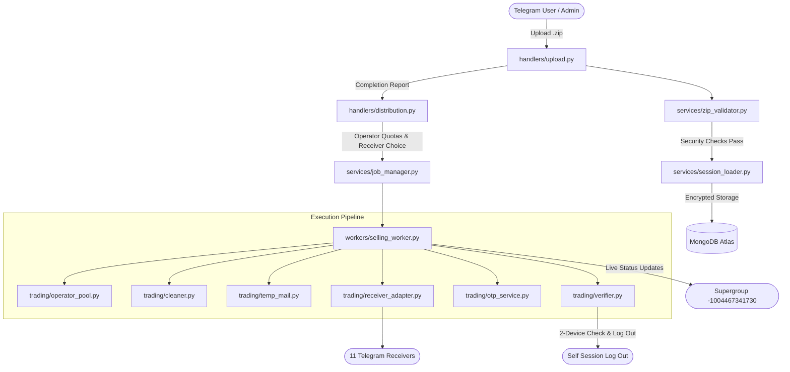

# Telegram ZIP Auto-Selling Engine & Operator Distribution Bot

> **Enterprise-grade automation bot implementing the complete Developer-Ready Workflow and Technical Specification for Telegram ZIP archive processing, multi-operator quota allocation, and autonomous receiver arbitrage.**

---

## 📌 1. Project Overview

The **Telegram ZIP Auto-Selling Bot** allows administrators and authorized operators to upload compressed `.zip` archives containing Telegram session files (`.session`, `.json`), safely validate and index them without leaking sensitive credentials, interactively distribute batches among active operators according to custom quotas, route accounts to the most profitable Telegram receiver bots, and autonomously verify payouts.

### Key Capabilities
- **Strict ZIP Security:** Validates archive size, prevents path traversal (`../`), blocks ZIP bombs (ratio > 100:1), rejects symlinks, and denies executables (`.exe`, `.sh`, `.bat`, etc.).
- **Zero-Secret Leakage Guarantee:** Strictly prevents forwarding or exposing MTProto session keys, login codes, passwords, or 2FA credentials in Telegram messages or public logs.
- **Dynamic Operator Quotas:** Admin can allocate custom session counts across registered operators (e.g., `OP-9879: 8`, `Operator-2: 14`) via interactive inline buttons or `/quota`.
- **Intelligent Receiver Routing:** Routes accounts dynamically to the highest-paying receiver for each specific country code, or forces submission to selected receivers with optional limits.
- **Battle-Tested MTProto Selling Engine:**
  - Kicks old sessions (`ResetAuthorizationsRequest`).
  - Cleans dialogs and deletes contacts.
  - Changes/binds free auto temp emails.
  - Automatically fetches OTPs from Telegram official notifications (`777000`).
  - Handles receiver prompts (Star Bot confirmation buttons, NewFast late 2FA, CM/BR/Crazy confirmation dialogues).
  - Enforces strict 2-device check (ours + receiver) and executes self-session termination (`client.log_out()`), preserving the buyer's session.

---

## 🏗️ 2. System Architecture



---

## 🛠️ 3. End-to-End Workflow (Stages 01 – 07)

| Stage | Name | Description |
|:---|:---|:---|
| **01** | **Start & Auth** | User starts `/start`. The system registers user, checks RBAC permissions, and displays current system status. |
| **02** | **Upload Archive** | Admin uploads a `.zip` archive (up to 50 MB compressed, 200 MB uncompressed, max 500 files). |
| **03** | **Validate Security** | `ZipValidator` verifies ZIP magic bytes, inspects file tree for path traversal, tests compression ratios, and rejects dangerous extensions. |
| **04** | **Safe Extraction** | Files are extracted to an isolated, sandboxed directory (`tempfile`). `.session` SQLite and `.json` companions are parsed, phones are normalized and masked, and binary session bytes are encrypted via AES-256-GCM. SHA-256 archive fingerprint is stored. |
| **05** | **Distribute Quotas** | Admin is presented with interactive distribution options: **All to Operator 1**, **Even Split across Operators**, or **Custom Quota** via `/quota OP-1:8,OP-2:14`. Admin then selects target receiver (Auto Yield or specific receiver). |
| **06** | **Execute Auto-Sell** | Background worker spins up operator MTProto clients, cleans the account, binds temp email, posts phone number to receiver bot, monitors Telegram service notifications for login OTP, supplies OTP, confirms sale, and logs out our device. |
| **07** | **Report & Payout** | Live summary is broadcast to Admin Log (`-1004467341730`) with profit metrics, receiver prices, and completion status. |

---

## 🤖 4. Supported Receivers (11 Verified Profiles)

| Receiver Bot | Description & Custom Dialect Protocol |
|:---|:---|
| `@tg_get2_bot` | Large country catalog; parses phone number, returns price quote, waits 7200s verification. |
| `@sttar1_bot` | Multi-step interactive flow; requires parsing inline confirmation button `[You will get $X.XX]`. |
| `@tglionapi_bot` | Fast automated API receiver with real-time price lookup and fast OTP exchange. |
| `@newfast_receiver_bot` | High volume; adds late 2FA password; handled by awaiting `🔐 The account with the number ... was successfull` before self-logout. |
| `@cm_receiver6_bot` | Standardized modern flow: `💫 Processing please wait...` ➔ OTP request ➔ `🛍 Account Received!` (logout in 10 mins). |
| `@br_receiver6_bot` | Identical protocol to CM Receiver with independent pricing catalog and dedicated quotas. |
| `@crazy_timeacc2_robot` | Fast payout engine matching CM/BR protocol with high priority for select Asian / LATAM countries. |
| `@jiareceiver8bot` | Specialized daily receiver for fast payout and high capacity. |
| `@jia_onyx_bot` | Dedicated high-yield receiver for premium tier numbers. |
| `@tbunlimited2_bot` | Backup receiver with wide global coverage. |
| `@godzillareceiverbot` | High-capacity backup receiver for bulk batch absorption. |

---

## 🔒 5. Security & Verification Constraints

1. **Path Traversal Shield:** Rejects any entry containing `..`, absolute paths, drive letters, or null bytes.
2. **ZIP Bomb Shield:** Enforces strict limits:
   - Compressed size ≤ 50 MB
   - Uncompressed total size ≤ 200 MB
   - Max file count ≤ 500 files
   - Compression ratio ≤ 100:1
3. **Session Data Protection:** Session strings and Telethon session files are encrypted using AES-256-GCM before entering the database.
4. **Zero Log Exposure:** Plaintext 2FA passwords, session auth keys, and OTP login codes are strictly stripped and masked in all logs, messages, and reports.
5. **Session Termination Safety:** After receiving receiver confirmation, the worker queries active authorizations. If rogue 3rd devices exist, they are terminated. Then, **only our Telethon client calls `client.log_out()`**, ensuring the buyer remains authorized.

---

## 🚀 6. Deployment Guide

### Local / Server Setup

```bash
# Clone or navigate to project directory
cd TelegramZipAutoSeller

# Create and activate Python virtual environment
python -m venv .venv
source .venv/bin/activate  # On Windows: .venv\Scripts\activate

# Install dependencies
pip install -r requirements.txt

# Configure environment
cp .env.example .env
# Edit .env with your BOT_TOKEN and MongoDB credentials

# Run test suite
python -m unittest discover tests

# Launch bot
python bot.py
```

### Heroku Platform API Deployment

The repository includes `deploy_heroku.py` for fully automated deployment to Heroku:

```bash
python deploy_heroku.py
```

This script automatically packages the application, uploads the source tarball to Heroku Platform API v3, provisions environment variables, builds the container, and scales the worker dyno.

---

## 👥 7. Administrative Commands

| Command | Permission | Description |
|:---|:---|:---|
| `/start` | Public | Register user, show main menu and specifications. |
| `/upload` | Authorized | Guide for uploading `.zip` archives. |
| `/quota <rules>` | Admin | Set custom operator quotas (e.g., `/quota OP-9879:10,OP-2:15`). |
| `/history` | User/Admin | View past upload jobs and sell statuses. |
| `/admin` | Admin | Administrator control dashboard with system metrics. |
| `/users` | Admin | List registered Telegram users. |
| `/jobs` | Admin | Inspect active and completed job queue. |
| `/logs` | Admin | View non-sensitive security audit trail. |
| `/operators` | Admin | List active MTProto trading operators. |
| `/addoperator <id> <phone>` | Admin | Register new operator account. |
| `/ban <user_id>` / `/unban <user_id>` | Admin | Manage user access control. |
| `/broadcast <text>` | Admin | Send announcement to all registered users. |
